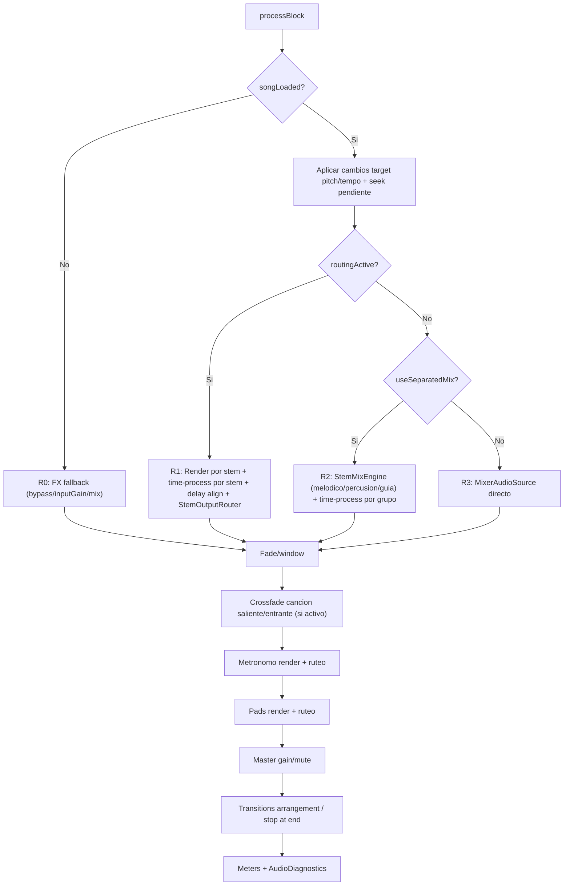
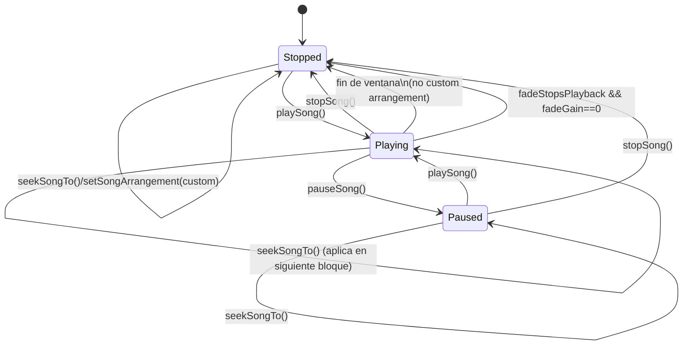

# Motor de Audio (PlayWorship) - Especificacion Tecnica Runtime

Este documento define el comportamiento tecnico del motor de audio actual en tiempo real.
La fuente de verdad es el codigo C++ existente; aqui no se proponen cambios de arquitectura ni de API.

## 1. Proposito, Alcance y Limites

### Proposito
- Documentar de forma trazable como se genera, procesa, enruta y monitorea el audio durante `prepareToPlay` y `processBlock`.
- Permitir que otro ingeniero reconstruya el pipeline mental completo sin abrir el codigo.

### Alcance incluido
- Pipeline runtime end-to-end.
- Carga y reproduccion de stems.
- Transporte, arrangement, seek, fade y crossfade.
- Pitch/tempo, compensacion de latencia y sincronizacion.
- Ruteo multicanal de stems/metronomo/pads.
- Diagnosticos operativos `AudioDiagnostics`.
- Interfaces publicas del motor (sin cambios de firma).

### Limites
- No se modifica logica DSP ni estado de sesion/autenticacion.
- La UI se menciona solo cuando inyecta configuracion al motor (mascaras/ruteos/controles).

### Modulos fuente (trazabilidad)
- `src/PluginProcessor.h/.cpp` (`MTControlsAudioProcessor`)
- `src/StemTrack.h/.cpp`
- `src/StemBufferingSource.h/.cpp`
- `src/ResamplingPositionableSource.h/.cpp`
- `src/StemMixEngine.h/.cpp`
- `src/PitchShiftProcessor.h/.cpp`
- `src/audio/SimpleDelayLine.h/.cpp`
- `src/audio/StemOutputRouter.h/.cpp`
- `src/audio/StemOutputRoutingState.h/.cpp`
- `src/MetronomeEngine.h/.cpp`
- `src/audio/PadsEngine.h/.cpp`
- `src/AudioDiagnostics.h`
- `src/data/SongData.h/.cpp`
- `src/PluginEditor.cpp` (inyecta mascara click/guide y pitch-shiftable al motor)

## 2. Inventario de Componentes y Responsabilidades

| Componente | Responsabilidad runtime | Referencia de codigo |
| --- | --- | --- |
| `MTControlsAudioProcessor` | Orquestacion central: `prepareToPlay`, `processBlock`, transporte, mezcla, ruteo, metronomo, pads, MIDI mapping, persistencia APVTS/ruteo. | `src/PluginProcessor.h/.cpp` |
| `StemTrack` | Fuente por stem: lectura buffered + resampling + controles lock-free (volume/trim/mute/solo) y nivel para meter. | `src/StemTrack.h/.cpp` |
| `StemBufferingSource` | Ring buffer de lectura anticipada en thread de fondo por stem para reducir I/O en audio thread. | `src/StemBufferingSource.h/.cpp` |
| `ResamplingPositionableSource` | Adapta sample rate del archivo al sample rate de salida, mantiene posicion logica de lectura. | `src/ResamplingPositionableSource.h/.cpp` |
| `StemMixEngine` | Mezcla separada por grupos (melodico/percusion/guia), time-processing por grupo y alineacion por latencia. | `src/StemMixEngine.h/.cpp` |
| `PitchShiftProcessor` | Wrapper SoundTouch para pitch/tempo, perfiles de calidad por contenido y gestion de latencia inicial. | `src/PitchShiftProcessor.h/.cpp` |
| `SimpleDelayLine` | Compensacion de latencia por delay de muestras para alinear rutas con distinta latencia de proceso. | `src/audio/SimpleDelayLine.h/.cpp` |
| `StemOutputRouter` | Ruteo final de buffers a canales fisicos (mono o stereo), con fold-down stereo->mono cuando aplica. | `src/audio/StemOutputRouter.h/.cpp` |
| `StemOutputRoutingState` | Estado persistible de canal base + ancho por stem y normalizacion contra capacidad del dispositivo. | `src/audio/StemOutputRoutingState.h/.cpp` |
| `MetronomeEngine` | Sintesis de click interno (fase/beat), mute/volume, sincronizacion por tiempo de cancion. | `src/MetronomeEngine.h/.cpp` |
| `PadsEngine` | Reproduccion de pads por nota con crossfade, voice management y mezcla al bus principal por ruteo. | `src/audio/PadsEngine.h/.cpp` |
| `AudioDiagnostics` | Logger lock-free de rendimiento de bloque y telemetria de latencia por stem con flush en thread de fondo. | `src/AudioDiagnostics.h` |

## 3. Modelo de Estado y Concurrencia

### Hilos relevantes
- Audio thread: ejecuta `processBlock`.
- UI/message thread: setea parametros y llama APIs publicas (`setStemVolume`, `setPitchSemiTones`, etc.).
- Thread por stem (`StemTrack::readThread`): prefetch de audio.
- Thread de flush de diagnosticos (`AudioDiagnostics::FlushThread`): drena ring buffers a CSV.

### Estado lock-free (atomics)
- Controles per-stem: volumen, gain, mute, solo, clickGuide, pitchShiftable, canal, ancho.
- Estado master/metronomo/pads.
- Estado transporte: `transportState`, `songCurrentPositionSeconds`, `globalSamplePosition`, `seekPending`, `seekTargetSeconds`.
- Niveles de medidor L/R y por stem.

### Locks y uso
- `stemListLock` (`juce::SpinLock`): protege cambios estructurales en vectores de stems/arrangement durante lectura en runtime.
- `padsStateLock` (`juce::SpinLock`): serializa acceso a `padsEngine`; en audio thread se usa `ScopedTryLock` para evitar bloqueo duro.
- `midiBindingsLock` (`juce::CriticalSection`): protege mutacion de mapa MIDI bindings.
- `songMetaLock` (`juce::ReadWriteLock`): protege strings de metadata (`loadedSongTitle`, `loadedSongKey`).
- `StemBufferingSource` usa `callbackLock` y `bufferRangeLock` para sincronizar buffer compartido entre thread de fondo y audio callback.

## 4. Ciclo de Vida Runtime

### `prepareToPlay`
Implementado en `MTControlsAudioProcessor::prepareToPlay`.

Acciones principales:
- Prepara `gain`, buffers temporales, `mixEngine` y `outgoingMixEngine`.
- Prepara arrays per-stem de `PitchShiftProcessor` y `SimpleDelayLine` para ruteo explicito.
- Normaliza ruteos (`stemOutputRoutingState.normalizeForDevice`).
- Prepara `metronome`, `mixerSource`, `outgoingMixerSource`, `padsEngine`.
- Prepara cada `StemTrack` cargado.
- Inicia logger de diagnosticos (`AudioDiagnostics::startBackgroundLogger`).

### `releaseResources`
- Libera recursos de mezcla, pads, mixers y tracks.
- Detiene logger de diagnosticos.

### Carga de cancion (`loadSongStems`)
Implementado en `MTControlsAudioProcessor::loadSongStems`.

Resumen:
- Crea `StemTrack` por archivo valido (hasta `maxStemCount`).
- Si habia cancion reproduciendo, mueve stems actuales a `outgoingStemTracks` y activa crossfade.
- Reemplaza entradas de `mixerSource` con los nuevos stems.
- Resetea estado de stem controls y metadata de cancion.
- Inicializa arrangement por defecto (`0..songLength`) y estado de transporte.

## 5. Flujo de Audio en `processBlock`

Funcion central: `MTControlsAudioProcessor::processBlock`.

### 5.1 Matriz de rutas de ejecucion

| Ruta | Condicion de entrada | Mecanismo de mezcla | Time-processing | Salida/ruteo |
| --- | --- | --- | --- | --- |
| `R0` (FX fallback) | `songLoaded == false` | Buffer de entrada con `inputGain` + mezcla `dry/wet` si no bypass | No aplica pitch/tempo de song engine | Sale por bus principal |
| `R1` (Song + ruteo explicito) | `songLoaded == true` y `routingActive == true` | Render per-stem a `stemRoutingTempBuffer` y suma por `StemOutputRouter` | Per-stem (`stemPitchProcessors`, `stemPitchDelayLines`) | Canal base + ancho por stem |
| `R2` (Song + mezcla separada) | `songLoaded == true`, `routingActive == false`, `useSeparatedMix == true` | `StemMixEngine` separa melodico/percusion/guia y luego suma | Por grupo (`PitchShiftProcessor` y delays en `StemMixEngine`) | Suma a buffer principal |
| `R3` (Song + mezcla simple) | `songLoaded == true`, `routingActive == false`, `useSeparatedMix == false` | `MixerAudioSource` directo de `StemTrack` | No | Suma stereo/default |

`routingActive` se activa cuando al menos un stem:
- esta asignado a canal base `> 1`, o
- esta en modo mono (`width == 1`) con salida multicanal.

`useSeparatedMix` se activa cuando:
- hay fade global en progreso, o
- hay window fade activo, o
- hay pitch (`pitchActiveSemiTones != 0`), o
- hay cambio de tempo (`playbackTempoRatioActive != 1.0`).

### 5.2 Etapas comunes en ruta con cancion cargada
- Limpieza de buffer de salida.
- Aplicacion de cambios pendientes de pitch/tempo target.
- Aplicacion de seek pendiente (`seekPending`) de forma atomica para todos los stems.
- Actualizacion de estado por stem (mute/solo/volume/trim) y niveles de UI.
- Evaluacion de ventanas (`songStart`, `songEnd`, `songFadeOut`) y arrangement.
- Mezcla segun ruta `R1/R2/R3`.
- Aplicacion de fade global y fade de ventana.
- Crossfade de cancion saliente/entrante si `songCrossfadeActive`.
- Render/metronomo y luego render/pads.
- Aplicacion de master output gain/mute.
- Transicion de arrangement part o `stopSong` al final de ventana.
- Actualizacion de medidores L/R y eventos de diagnostico.

## 6. Reglas de Time-Processing (Pitch/Tempo/Latencia)

### 6.1 Motor por stem (ruta `R1`, ruteo explicito)
Referencia: `processBlock` + arrays `stemPitchProcessors/stemPitchDelayLines`.

- `timeProcessActive = (pitch != 0) || (tempoRatio != 1.0)`.
- Por stem:
  - `pitchShiftable` viene de `setStemPitchShiftMask`.
  - `shouldProcess = tempoActive || pitchShiftable`.
  - Si procesa:
    - `setContentType(Melodic|Percussive)` segun mascara.
    - pitch aplicado solo si `pitchShiftable`; percusivo recibe `0` semitonos.
    - tempo se aplica siempre cuando `tempoActive`.
- Latencia objetivo global de la pasada:
  - `targetLatency = max(latencia_por_stem_procesado)`.
  - Delay por stem = `targetLatency - latencia_stem`.
- Se instrumenta snapshot periodico en `AudioDiagnostics::StemTimingEvent`.

### 6.2 Motor por grupos (ruta `R2`, mezcla separada)
Referencia: `StemMixEngine::mixStems` y `StemMixEngine::renderToOutput`.

- Clasificacion por stem:
  - `dryBuffer`: click/guide (`setStemClickGuideMask`).
  - `stemMixBuffer`: melodicos pitch-shiftable.
  - `percussionBuffer`: stems no pitch-shiftable.
- Procesamiento:
  - Melodicos: `pitchShiftMelodic` (pitch + tempo).
  - Percusion y guia: solo `tempoShift*` cuando tempo activo.
- Alineacion:
  - Se calcula latencia de cada grupo.
  - Se aplica delay compensatorio con `pitchDelayMelodic/percussion/guide`.

### 6.3 Perfiles de calidad SoundTouch
Referencia: `PitchShiftProcessor::configureQualitySettings`.

- Melodico:
  - ratio `< 0.85`: perfil `0` (`sequence=95ms`, `seek=35ms`, `overlap=12ms`).
  - ratio `< 0.999`: perfil `1` (`82/28/10`).
  - ratio `>= 0.999`: perfil `2` (`46/18/8`).
- Percusivo:
  - ratio `< 0.88`: perfil `3` (`58/14/6`).
  - ratio `< 0.999`: perfil `4` (`50/13/6`).
  - ratio `>= 0.999`: perfil `5` (`40/10/6`).
- `SETTING_USE_QUICKSEEK = 0` (prioriza calidad sobre CPU).

### 6.4 Reglas de flush/reset para evitar historia obsoleta

- Cambio de pitch target detectado en `processBlock`:
  - actualiza `mixEngine/outgoingMixEngine`.
  - ejecuta `flushRoutingTimeProcessors`.
- Cambio de tempo:
  - si pitch activo y se cruza unidad (1.0) o cambia perfil de calidad: `flushAllTimeProcessingState`.
  - si no, reinicia contadores de latencia de ruteo.
- Seek:
  - despues de mover posicion de todos los stems, ejecuta `flushAllTimeProcessingState`.
- En `PitchShiftProcessor`:
  - `setPitchSemiTones`: `reset()` inmediato.
  - `setContentType`: `reset()` inmediato.
  - `setTempoRatio`: reset solo si cambia perfil; si no, refresca latencia.

## 7. Transporte y Arrangement

### Transporte base
- Estados: `stopped`, `playing`, `paused`.
- API: `playSong`, `pauseSong`, `stopSong`, `toggleSongPlayPause`, `seekSongTo`, `seekSongRelative`.

### Ventanas y fade
- Ventana activa por `songStartSeconds` y `songEndSeconds`.
- Fade de salida de ventana por `songFadeOutSeconds`.
- Fade global master independiente por `fadeActive/fadeTarget/fadeDurationSec`.
- Si `fadeStopsPlayback == true` y fade global llega a 0 en `playing`, se ejecuta `stopSong`.

### Arrangement runtime
- Partes runtime en `arrangementParts` (`startSec`, `endSec`).
- Soporta:
  - arreglo personalizado (`arrangementCustomActive`),
  - salto pendiente de parte (`arrangementPendingJumpPartIndex`),
  - loop de parte (`arrangementLoopPartIndex`).
- En fin de bloque/ventana decide:
  - transicion a parte siguiente,
  - salto a parte pendiente,
  - loop a inicio de parte,
  - o stop al final.

### Crossfade entre canciones
- Activacion: al cargar nueva cancion mientras la actual seguia reproduciendo.
- Duracion fija: `songCrossfadeDurationSec = 2.5`.
- `buffer` (incoming) sube de 0->1 y `outgoingStemRenderBuffer` baja de 1->0.
- Al completar, se limpia `outgoingStemTracks`.

## 8. Ruteo de Salida Multicanal

### Modelo
- Cada stem tiene:
  - canal base 1-based (`stemOutputChannel`),
  - ancho (`stemOutputWidth`: 1 mono, 2 stereo).
- El estado persistente se mantiene en `StemOutputRoutingState`.

### Normalizacion por dispositivo
- `normalizeForDevice(maxOutputChannels)` ajusta:
  - canal dentro de rango disponible.
  - si `width=2` y no hay par disponible, corrige base channel.
  - si dispositivo tiene menos de 2 salidas, fuerza ancho mono.

### Regla de enrutado en `StemOutputRouter`
- `width=2`:
  - stem mono: duplica a L/R.
  - stem stereo: copia L->canal base, R->canal base+1.
- `width=1`:
  - stem mono: copia directo al canal base.
  - stem stereo: fold-down `(L+R)*0.5` para evitar clipping y mantener balance.

### Pads: regla adicional de mirroring
- Si ruteo pads es stereo y una banda esta casi silenciosa (`threshold 1e-5`), copia lado activo al otro para asegurar audibilidad en ambos canales.

## 9. Metronomo y Click Real/Virtual

### Fuente metronomo
- `MetronomeEngine` genera click sintetico (seno con envolvente exp decay).
- Se sincroniza por tiempo de cancion (`syncPhaseForTimeSeconds`).

### Audibilidad con solo/mute
- `metronomeAudible = !muted && (!anySoloActive || soloed)`.
- Si no existe stem click real y metronomo esta en solo, se considera solo activo global para mutear stems musicales y dejar click.

### Herencia desde stem click real
- Si `metronomeClickStemIndex` apunta a stem valido:
  - volumen, gain, mute, solo, canal y ancho del metronomo se toman desde ese stem.
- Si no hay stem click real:
  - usa estado dedicado de metronomo (`metronomeVolumeState`, `metronomeGainState`, etc.).

## 10. Integracion de Pads en Runtime

- `padsPackLoaded` habilita render de pads en bloque.
- `padsEngine.process()` se invoca bajo `ScopedTryLock` para no bloquear audio thread si lock no esta disponible.
- Pads se suman despues del metronomo y antes de master output.
- Gain de salida pads:
  - `padsMuted ? 0 : clamp(padsVolume,0..1) * clamp(padsGain,0..2)`.

## 11. Interfaces Publicas del Motor (Sin Cambios de API)

Fuente: `MTControlsAudioProcessor` en `src/PluginProcessor.h`.

| Dominio | API publica relevante |
| --- | --- |
| Carga y transporte | `loadSongStems`, `playSong`, `pauseSong`, `stopSong`, `toggleSongPlayPause`, `seekSongRelative`, `seekSongTo` |
| Ventana/arrangement | `setSongStartSeconds`, `setSongEndSeconds`, `setSongFadeOutSeconds`, `setSongArrangement`, `requestArrangementPartJump`, `toggleArrangementPartLoop`, `clearArrangementPartLoop` |
| Estado de reproduccion | `hasLoadedSong`, `isSongPlaying`, `getSongCurrentPositionSeconds`, `getSongLengthSeconds`, `getLoadedSongBpm`, `getLoadedSongKey`, `getLoadedSongTitle` |
| Stems (mix) | `getLoadedStemCount`, `getStemLevel`, `setStemVolume/getStemVolume`, `setStemGain/getStemGain`, `setStemMute/isStemMuted`, `setStemSolo/isStemSoloed` |
| Ruteo stems | `setStemOutputChannel/getStemOutputChannel`, `setStemOutputWidth/getStemOutputWidth`, `getAvailableOutputChannelNames`, `getAvailableOutputChannelCount`, `getCurrentAudioMode` |
| Master | `setMasterVolume/getMasterVolume`, `setMasterGain/getMasterGain`, `setMasterMute/isMasterMuted` |
| Pitch/tempo | `setStemPitchShiftMask`, `setPitchSemiTones/getPitchSemiTones`, `setPlaybackTempoBpm/getPlaybackTempoBpm`, `getOriginalSongBpm` |
| Metronomo | `setMetronomeEnabled/isMetronomeEnabled`, `setMetronomeBpm/getMetronomeBpm`, `setMetronomeBeatsPerBar`, `setMetronomeVolume/getMetronomeVolume`, `setMetronomeMuted/isMetronomeMuted`, `setMetronomeGain/getMetronomeGain`, `setMetronomeSolo/isMetronomeSolo`, `setMetronomeOutputRouting`, `setMetronomeClickStemIndex` |
| Pads | `loadPadsPackFromFolder`, `reloadLastPadsPack`, `ensurePadsPackReady`, `refreshPadsRoutingFromSettings`, `setPadsEnabled/isPadsEnabled`, `setPadsVolume/getPadsVolume`, `setPadsGain/getPadsGain`, `setPadsCrossfadePreset/getPadsCrossfadePreset`, `triggerPadNote`, `stopPadNote`, `getPadsOutputLevel`, `isPadsPackLoaded`, `getPadsPackStatusText` |
| MIDI bindings | `getMidiTargets`, `getMidiBindings`, `setMidiBinding`, `clearMidiBindingForTarget`, `beginMidiLearnForTarget`, `consumePendingMidiLearnBinding`, `consumePendingMidiUiCommand`, `getLastMidiInputProbe` |
| Estado plugin | `getValueTreeState`, `getStateInformation`, `setStateInformation`, `getOutputMeterLevels` |

## 12. Diagnosticos Operativos (`AudioDiagnostics`)

### Que mide
- Duracion real de `processBlock` vs budget temporal del bloque.
- Espera de lock (`lockWaitMs`) para `stemListLock`.
- Overruns (`blockMs > budgetMs`).
- Snapshot de latencia/delay por stem en ruteo explicito.

### Estructuras
- `DiagEvent`:
  - `wallMs`, `blockMs`, `budgetMs`, `lockWaitMs`, `stemCount`, `overrun`, `isPlaying`.
- `StemTimingEvent`:
  - `wallMs`, `tempoRatio`, `pitchSemiTones`, `stemCount`, `targetLatencySamples`, `routingActive`, `timeProcessActive`, `tempoActive`.
  - por stem: `processLatencySamples`, `delaySamples`, `flags`.
  - flags:
    - bit0: stem procesado
    - bit1: stem pitch-shiftable
    - bit2: contenido percussive profile

### Salida CSV
- `audio_<timestamp>.csv` (eventos por bloque).
- `audio_stems_<timestamp>.csv` (metricas por stem).
- Flush en background cada 500 ms.

## 13. Invariantes y Limites Tecnicos

| Parametro / limite | Valor | Donde aplica | Consecuencia funcional |
| --- | --- | --- | --- |
| Max stems | `64` (`maxStemCount`) | Carga, arrays atomicos, ruteo | No se cargan mas de 64 stems |
| Output channels soportados | `1..64` | `isBusesLayoutSupported` | Rechaza layouts fuera de rango |
| Tempo BPM | `20..300` | `setPlaybackTempoBpm`, `setMetronomeBpm` | Evita tempo extremo |
| Ratio tempo | `0.75..2.0` | `getPlaybackTempoRatio`, `PitchShiftProcessor::setTempoRatio` | Limita time-stretch |
| Stem volume | `0..1` | `setStemVolume` | Ganancia lineal de mezcla por stem |
| Stem gain/trim | `0..2` | `setStemGain` | Ajuste extra por stem |
| Master volume | `0..1` | `setMasterVolume` | Control principal de nivel |
| Master gain | `0..2` | `setMasterGain` | Boost/cut adicional master |
| Metronome volume | `0..1` | `setMetronomeVolume` | Nivel base del click |
| Metronome gain | `0..2` | `setMetronomeGain` | Trim adicional click |
| Pads volume | `0..1` | `setPadsVolume` | Nivel base pads |
| Pads gain | `0..2` | `setPadsGain` | Trim adicional pads |
| Output width | `1..2` | stems/metronome/pads | Mono o stereo por fuente |
| Pitch latency buffer max | `65536` samples | Delay lines de ruteo y mezcla separada | Tope de compensacion |
| Fade global duration | `2.0 s` | `fadeDurationSec` | Ramp de fade global |
| Song crossfade duration | `2.5 s` | `songCrossfadeDurationSec` | Duracion transicion entre canciones |
| Min duracion parte arrangement runtime | `0.25 s` | `setSongArrangement` | Filtra partes demasiado cortas |

## 14. Integracion de Mascaras desde Datos de Cancion

La clasificacion de stems que consume el motor se define antes de llamar `loadSongStems`:

- `setStemClickGuideMask`:
  - true para stems prioridad click/guide.
- `setStemPitchShiftMask`:
  - true para stems pitch-shiftable (`SongData::isStemPitchShiftable`).
  - `Drums`, `Percussion`, `Click`, `Cues` => no pitch.
- `setMetronomeClickStemIndex`:
  - primer stem detectado como click si existe.

Referencia de inyeccion:
- `src/PluginEditor.cpp` (carga de cancion y armado de mascaras).
- `src/data/SongData.cpp` (`stemPriorityForStripOrder`, `isStemPitchShiftable`).

## 15. Diagrama de Flujo Principal

## 16. Maquina de Estados de Transporte

## 17. Notas Finales de Verificacion

- Todas las reglas documentadas arriba referencian modulos y funciones existentes.
- No se introducen contratos nuevos de API ni semanticas especulativas.
- Este documento debe mantenerse sincronizado con cambios futuros en:
  - `MTControlsAudioProcessor::processBlock`
  - `StemMixEngine`
  - `PitchShiftProcessor`
  - `MetronomeEngine`
  - `StemOutputRouter` y estado de ruteo
